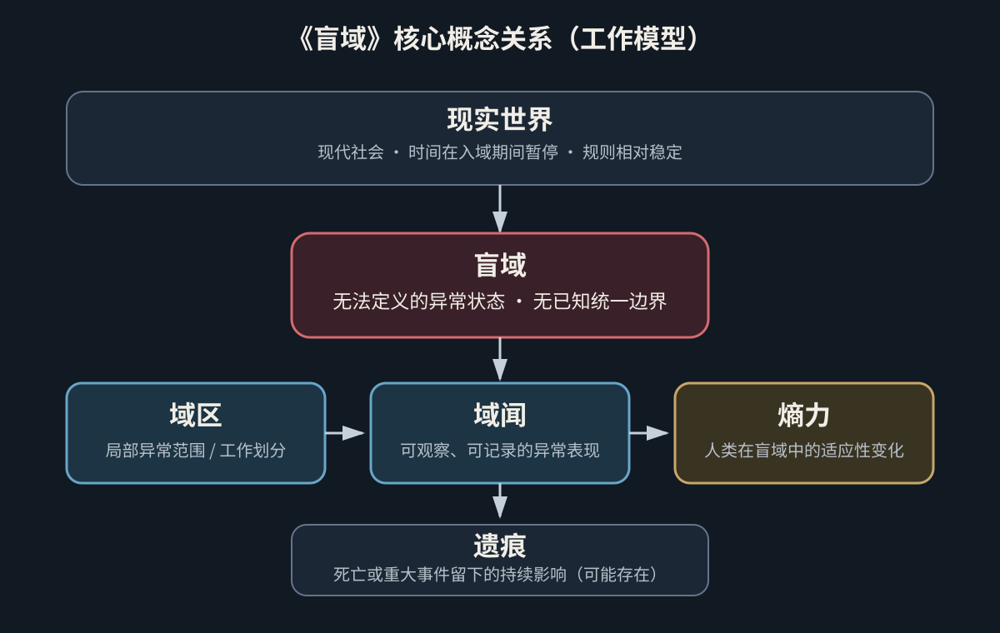

# 00｜世界观总览

## 一句话概念

现代社会的日常秩序之外，存在一种无法被定义的异常状态------**盲域**。人类可能在极端处境中意外进入其中，遭遇遵循特殊规则的**域闻**，并在求生过程中觉醒独属于自己的**熵力**。

盲域没有被证实的统一边界，也没有可靠的全貌。它可能表现为空间、事件、信息、实体，甚至是一种现实状态的改变。人类能够记录局部规律，却无法确认这些规律是否属于同一个整体。

## 核心元素

  名称   定位                                 核心问题
  ------ ------------------------------------ --------------------------
  盲域   无法定义的异常状态                   我们究竟进入了什么？
  域区   调查者对相对稳定异常区域的工作称呼   这里的规则如何运行？
  域闻   盲域中可观察到的异常现象             它遵循什么规则？
  域体   具有实体或生命特征的域闻             它是否理解人类？
  熵力   人类在盲域中产生的适应性变化         人类如何在异常中生存？
  遗痕   死亡或重大事件留下的持续影响         生命消失后还会留下什么？
  域漏   盲域现象对现实造成的影响             两者的边界是否可靠？

## 世界观关系

### 三种核心关系

1.  **盲域与域闻**：域闻是盲域中被观察、记录到的异常表现。它们不一定有敌意，也不一定都能被完整理解。
2.  **盲域与熵力**：熵力是人类在盲域环境中为了生存而产生的适应性变化。它不是外部组织发放的职业技能，也不是传统元素魔法。
3.  **死亡与盲域**：死亡可能改变域区、域闻或规则，也可能什么都没有留下。不同域区没有统一的死亡机制。

## 已确认的核心设定

-   世界背景为现代社会。
-   作品融合都市怪谈、灵异、探索和战斗。
-   人类第一次进入盲域，往往发生在极端处境中。
-   进入盲域后，现实世界的时间暂停。
-   域闻暂定五种：空间型、实体型、物品型、信息型、事件型。
-   域闻危险记录暂定为：未知（未记录）、无害、诡异、高危、极危、死亡（已知记录中无人存活）。
-   人在盲域中死亡，可能使盲域发生变化。
-   熵力在盲域中觉醒，能力之间不设绝对强弱关系。
-   熵力在盲域中使用不会产生现实污染；在现实中使用可能产生污染。
-   盲域本身的规模、结构和本质仍是谜。

## 建议采用的叙事结构

**单元怪谈 + 长线谜团 + 人物关系推进。**

-   单元怪谈：每个域闻或域区都能构成一个相对完整的探索故事。
-   长线谜团：不同域区之间是否存在联系？盲域是否有整体结构？熵力为什么会出现？
-   人物关系：队友之间的信任、隐瞒、牺牲、利益冲突，以及死亡后留下的影响。
-   组织冲突：官方、民间、灰色势力对同一域闻可能有完全不同的处理目标。

## 作品的体验目标

-   **恐怖**：未知感、规则压力、信息不完整、日常环境的异化。
-   **探索**：寻找线索、验证规则、绘制不可靠的域区关系图。
-   **战斗**：能力限制、环境利用、团队配合、临场判断。
-   **选择**：资源有限、时间有限、情报不完整时作出决定。
-   **余韵**：离开盲域后，人物仍要面对伤痕、记忆和无法向普通人解释的经历。

## 视觉与气质

现代建筑、空置商场、地铁站、写字楼、医院、地下停车场、老居民楼等日常场所，是盲域最有辨识度的视觉基础。不要只依靠血腥和怪物造型制造恐怖；熟悉环境中出现细小但无法解释的偏差，往往更有效。
