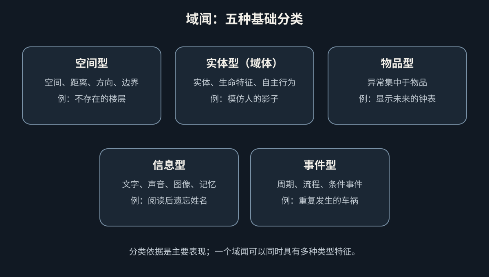

# 02｜域闻

## 1. 定义

**域闻**是对盲域中可观察、可记录的异常现象的统称。

域闻不等同于怪物。它可以是一片空间、一种实体、一件物品、一段信息、一种事件，也可以是多个类型混合形成的异常现象。

域闻可能有害、无害、具有交易性、保护性，或表现出无法判断的行为。不能因为某个现象外观恐怖，就直接认定它具有敌意。

## 2. 五种基础类型

### 2.1 空间型

异常主要表现为空间结构、距离、方向、边界或位置关系发生变化。

例子： - 不存在的楼层。 - 无限延伸的走廊。 -
进入后无法回到原入口的建筑。 - 两个相距很远的地点通过一扇门连接。 -
房间内部面积远大于外部建筑。

### 2.2 实体型（域体型）

异常主要表现为具有实体、生命特征或自主行为的存在。

例子： - 会模仿人类动作的影子。 - 只在特定灯光下出现的类人生物。 -
能够交流、交易或提出要求的未知存在。 -
没有固定身体，却能借用物品行动的存在。

**"域体"是实体型域闻的常用称呼。**
域体是否拥有意识、情绪、语言和社会结构，必须逐个调查，不能一概而论。

### 2.3 物品型

异常集中于某件物品或一组物品。

例子： - 永远显示五分钟前画面的监控屏。 -
能够记录尚未发生事件的笔记本。 - 只有在无人注视时才会改变位置的钥匙。 -
使用后会改变持有者记忆的电话。

物品型域闻不一定只能在盲域中存在；若物品被带出，可能引发现实污染或其他异常。

### 2.4 信息型

异常通过文字、声音、图像、记忆、知识或传播行为发挥作用。

例子： - 阅读后会让人忘记自己姓名的文本。 -
听到某段录音后，会在梦中反复进入同一地点。 -
只要知道某个名称，就会被某种存在感知。 -
观看特定图像后，开始看到现实中不存在的标记。

信息型域闻尤其适合档案恐怖：记录行为本身可能成为触发条件。

### 2.5 事件型

异常以某种周期、条件、流程或重复事件的形式出现。

例子： - 每晚固定时间重复发生的车祸。 - 进入房间后必须完成的一段流程。 -
每当有人死亡，某条走廊就会延长一次。 -
每隔一段时间，域区中的所有门都会交换位置。

## 3. 复合类型

**【建议设定】五种类型是分类工具，不是互斥的自然法则。**

一个域闻可以有一个主要类型和多个次要特征。

例如：一名只在午夜出现的护士，出现后会向特定人发送短信；收到短信的人若回复，就会在第二天出现在医院。它可以记录为"实体型为主，兼具信息型和事件型特征"。

## 4. 危险等级与记录状态

创作者原始方案为：未知、无害、诡异、高危、极危、死亡。

建议保留这些名称，但在档案中区分"危险评估"和"记录状态"，避免把未知误当成危险程度。

### 4.1 危险评估

  名称   含义
  ------ ------------------------------------------------
  无害   已知行为尚未造成直接伤害，且风险可控
  诡异   存在明显异常或心理压力，但通常可以通过规则规避
  高危   具有明确致伤、致死或严重失控风险
  极危   生还概率极低，逃离、控制或理解难度极高
  死亡   已知记录中没有确认生还者，或进入者均失联/死亡

"死亡"不是对绝对力量的评价，而是对已知生还记录的描述。未来若出现生还者，应更新档案，而不是把旧档案视为不可更改的真理。

### 4.2 记录状态

-   **未知／未记录**：尚无足够信息建立有效档案。
-   **部分记录**：存在零散目击或未经复现的线索。
-   **已记录**：有可追溯的调查记录。
-   **已验证**：关键规则经过重复验证。
-   **失效**：旧规则不再适用，或域闻已经发生变化。

### 4.3 档案标签示例

`危险评估：高危｜记录状态：已验证`

`危险评估：未知｜记录状态：未记录`

`危险评估：死亡｜记录状态：部分记录`

## 5. 规则结构

每个域闻至少需要从以下角度调查：

1.  **表现**：它看起来是什么，能观察到什么？
2.  **触发**：满足什么条件会发生异常？
3.  **作用对象**：影响人、物品、空间、记忆还是事件？
4.  **作用范围**：影响局部、整个域区，还是跨越区域？
5.  **规避方式**：什么行为能够降低风险？
6.  **代价**：规避、触发或利用规则需要付出什么？
7.  **例外**：有没有看似违反规则的案例？
8.  **变化条件**：什么情况会让旧规则失效？

## 6. 规则不是说明书

域闻的规则可以隐藏、误导、分层，甚至被域闻主动伪装。

但建议遵循一条创作原则：

**规则可以难以发现，但不能毫无因果地任意改变。**

如果一个规则发生变化，最好能追溯到原因，例如： - 有人死亡并留下遗痕。 -
域区进入新的周期。 - 某个域体迁移或改变行为。 - 探索者触发了隐藏条件。 -
人为机关改变了环境。 - 域漏或其他异常干扰了域区。

## 7. 域闻与人类

域闻不必全部是敌人。可以存在： - 无害的环境现象。 -
只要遵守规则就能共存的域体。 - 能够交换物资或情报的存在。 -
保护某个域区、但不允许人类深入的存在。 -
对人类没有善恶概念、只是在执行某种行为的现象。

"可交流"不代表"可信任"，"无害"也不代表"没有风险"。

## 8. 域闻与死亡

域闻可能因死亡产生变化，也可能完全不受影响。相关机制见《05_死亡与遗痕.md》。

## 9. 域闻创作检查表

-   它属于哪一种主要类型？
-   它最初会给人什么错误印象？
-   它真正的触发条件是什么？
-   至少有一条可被发现的线索吗？
-   它的规则能否被利用，而不只是被躲避？
-   它是否有不伤害人的可能？
-   它是否会因死亡、时间或人为干预而变化？
-   它的恐怖感是否来自规则本身，而不只是外形？
