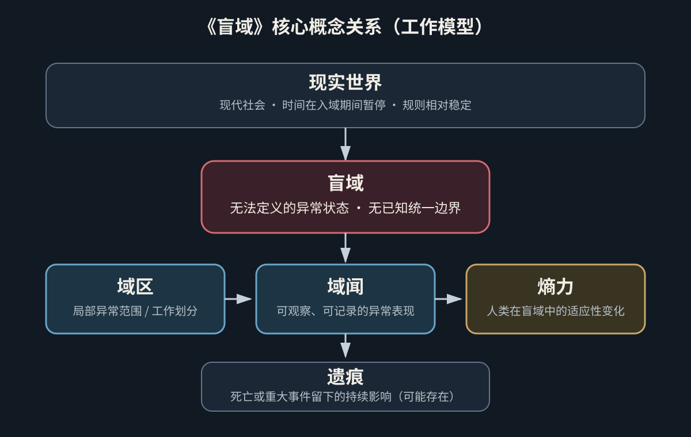

# 04｜域区

## 1. 定义

**域区**是调查者对盲域中一片相对稳定、可重复观察或具有共同异常特征的范围所使用的工作称呼。

域区是人类为了记录和沟通而建立的分类，不代表盲域本身一定由边界清晰的"房间"组成。

域区可以是： - 一座建筑或一组建筑。 - 一段道路、车站或地下空间。 -
一种周期性出现的事件范围。 - 一组通过信息、记忆或感知联系起来的地点。 -
一个不断变化、无法准确测绘的区域。 - 多种异常现象叠加形成的复合结构。

## 2. 域区与盲域的关系

盲域是更大的未知概念；域区是人类对局部异常的工作划分。

调查者说"我们进入了某个域区"，只代表他们认为自己进入了一组相对连续或相关的异常现象，并不证明域区之间一定存在物理通道。

## 3. 域区的常见形态

以下是调查描述，不是新的域闻类型。

  形态     描述
  -------- ----------------------------------------
  稳定型   多次进入时主要结构相对一致
  漂移型   路线、房间或边界会逐渐变化
  周期型   在特定时间或条件下重复出现
  嵌套型   一个域区内部存在多个更小的异常区域
  重叠型   同一地点可能同时表现出多套规则
  碎片型   只出现零散房间、走廊或短暂场景
  过渡型   常被用于描述不同异常区域之间的连接现象
  庇护型   在特定条件下相对安全，但不保证永久安全

## 4. 域区之间的连接

域区可能通过以下方式产生联系：

-   **空间连接**：门、楼梯、电梯、隧道、走廊。
-   **条件连接**：满足某种行为或时间条件后才能进入。
-   **事件连接**：完成某段事件后转入另一域区。
-   **信息连接**：通过录音、照片、文本或记忆建立联系。
-   **异常连接**：某个域闻同时影响多个域区。
-   **未知连接**：人员失踪、位置错位或其他无法解释的联系。

连接关系可能不对称。A能进入B，不代表B能返回A。

## 5. 地图与测绘

### 5.1 不存在可靠的总地图

**【已确认】盲域的整体规模和结构本身就是谜，甚至可能不存在统一答案。**

因此任何"盲域地图"都只能是局部调查成果。

### 5.2 建议的地图记录方式

地图应同时记录： - 已验证的路线。 - 未验证的路线。 - 进入条件。 -
退出条件。 - 最近一次通过时间。 - 规则变化记录。 - 失踪和死亡位置。 -
地图可信度。

### 5.3 地图可能失效

域区变化、遗痕、域体迁移、周期变化或人为机关都可能让旧地图失效。地图应有版本号和更新时间。

## 6. 域区生态

**【建议设定】不同域闻之间可能存在类似生态关系，但不必所有域区都有完整生态。**

可能关系包括： - 捕食：一个域体会追逐或吞噬另一种域闻。 -
寄生：某个域闻依附在另一个域闻或域区中。 -
共生：两个异常互相维持或保护。 - 竞争：争夺同一活动范围或触发条件。 -
回避：彼此不接触，甚至会相互驱离。 - 共存：没有明显的敌对或依赖关系。

人类不应轻易把这些关系理解为普通生物学意义上的食物链。

## 7. 安全区与据点

盲域中可以存在相对安全的区域，但"安全"必须附带条件。

例如： - 只要不进入某条走廊，域体就不会主动接近。 -
某个车站在列车停靠期间不会发生攻击。 -
一间房屋只保护遵守特定规则的人。 -
某个域体会保护固定数量的进入者，但不允许他们带走物品。

安全区可以成为人物关系、交易、休整和情报交换的场所，也可能因为规则变化而失效。

## 8. 域区变化的可能原因

-   有人在域区内死亡并留下遗痕。
-   某个域闻的触发条件被改变。
-   域体迁移、繁殖、消失或改变行为。
-   人类反复使用机关或改造环境。
-   域区进入新的周期。
-   域漏或现实污染影响了局部规则。
-   尚未发现的原因。

## 9. 错时相遇（可选设定）

**【待审核】极少数情况下，不同现实时间进入者可能在同一域区相遇。**

如果采用这一设定，建议把它作为罕见、难以验证的异常，而不是普遍规则。它可以制造"对某人而言是未来、对另一人而言是过去"的剧情，但会引入复杂的时间因果问题。

## 10. 域区创作检查表

-   这个域区的第一印象是什么？
-   它的主要异常是什么？
-   入口和出口是否稳定？
-   它的地图能否被重复验证？
-   是否有域闻、域体或机关？
-   它是否存在相对安全的区域？
-   域区是否会因死亡而变化？
-   这个域区能否提供探索、战斗或人物剧情？
