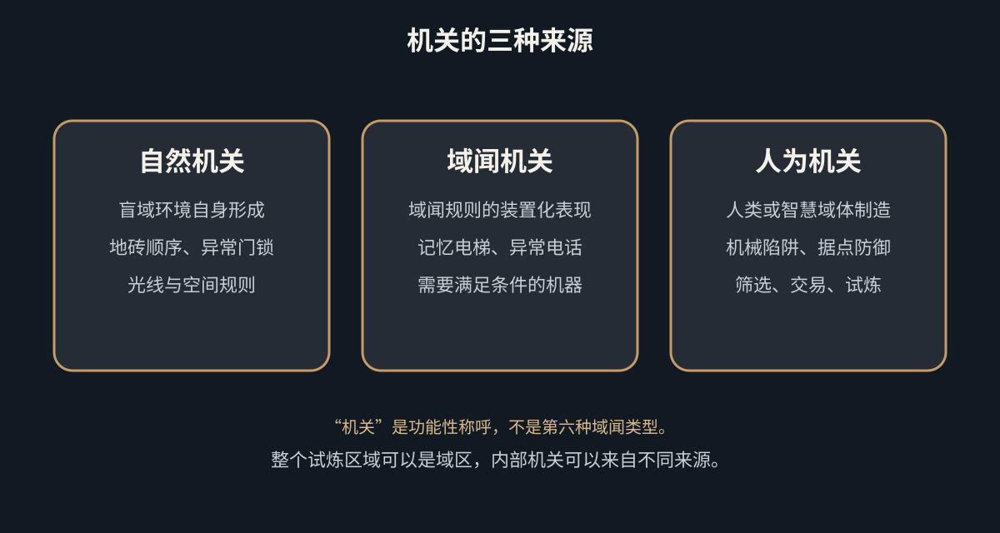

# 06｜机关与试炼

## 1. 是否引入《电锯惊魂》式机关？

**建议：引入，而且让它成为《盲域》的特色之一；但不要让整部作品变成密室逃脱合集。**

机关可以提供： - 倒计时压力。 - 规则理解与信息差。 - 资源分配。 -
团队合作和背叛。 - 道德困境。 - 环境战斗。 - 人类势力之间的冲突。

真正值得借鉴的不是单纯的血腥，而是"参与者必须理解规则，并在有限条件下作出选择"。

## 2. 机关不是第六种域闻类型

**【建议设定】机关是功能性称呼，不是新的异常分类。**

机关可以是： - 普通机械装置。 - 某个域闻的具体表现。 -
域区规则的一部分。 - 人类利用熵力制作的陷阱。 - 域体制造或维护的装置。

如果一整个区域都围绕机关和试炼运作，它可以被调查者称为"试炼型域区"，但其底层异常仍然可以属于空间型、事件型、物品型或复合类型。

## 3. 三种机关来源

### 3.1 自然机关

盲域环境本身形成的异常机制。

例子： - 走廊地砖必须按特定顺序踩踏。 -
某扇门只会在所有人背对它时打开。 -
房间每隔一分钟旋转一次，出口位置随之变化。 -
只有在灯光熄灭时，墙上的路线图才显示真实出口。

### 3.2 域闻机关

机关本身是域闻，或机关是域闻规则的可见载体。

例子： - 一台必须投入记忆才能启动的电梯。 -
一部会根据回答改变楼层的电话。 -
一台每次启动都会随机删除一段录音的机器。 -
一个必须由两名进入者分别完成不同动作的装置。

### 3.3 人为机关

由探索者、官方组织、民间势力、灰市商人或具有智慧的域体制作。

例子： - 用来保护物资仓库的机械陷阱。 - 为测试新成员而搭建的规则房间。 -
用熵力控制的简易锁闭装置。 - 为捕获域体而设置的诱导机关。

## 4. 机关设计类型

  类型     核心体验
  -------- ------------------------------------
  机械型   齿轮、锁、压力板、滑轨、绳索、配重
  规则型   必须遵守某条异常规则才能通过
  信息型   线索被拆分，参与者需要交换信息
  资源型   时间、工具、食物、药品或能源有限
  协作型   多人必须同步完成不同任务
  对抗型   有人或某种域体会干扰解谜
  伦理型   参与者面对利益冲突或牺牲选择
  混合型   多种机关机制叠加

## 5. 好机关的五条原则

### 5.1 有规则

机关必须有可以被理解的运行逻辑。规则可以不完整，但不能完全随机。

### 5.2 有线索

读者回头看时，应该能发现关键线索早已出现。线索可以藏在： -
划痕和磨损。 - 物品摆放。 - 声音或灯光变化。 - 说明文字中的歧义。 -
前一位参与者留下的痕迹。 - 机关反复出现的微小动作。

### 5.3 有代价

解法不一定免费。可能消耗工具、时间、物资、信任，或让角色暴露位置。

### 5.4 有选择

选择可以是真实的，也可以是参与者误以为存在的选择。后者尤其适合制造反转，但必须有线索支撑。

### 5.5 有后果

失败不一定是死亡。也可以是被困、失去物资、污染、队伍分离、域区变化或留下遗痕。

## 6. 道德困境不要滥用

不是每个机关都必须要求牺牲一个人。连续使用"二选一""牺牲队友"会让读者很快疲劳。

可以交替使用： - 看似必须牺牲，实际上存在第三种解法。 -
两个选择都能活，但会损失不同资源。 -
只有一个人掌握完整信息，团队必须决定是否信任他。 -
机关要求参与者说出真实信息，但真相会伤害队友。 -
解法本身不残酷，残酷的是参与者对规则的误解。 -
有人主动留下，但其他人发现这并非唯一解法。

## 7. 机关与熵力

机关是展示熵力智斗的理想场景。

例子： - "借位"交换锁芯中的零件。 -
"回声"重放机关启动时的声音，判断顺序。 -
"迟一拍"延缓锁闭，为拆解争取时间。 - "余温"判断哪一块踏板刚刚被压过。 -
"盲点"让守卫忽略某件静止工具。

但机关也可以专门针对熵力设计限制：某个装置会记录能力发动的痕迹，或某条规则只在使用熵力后触发。

## 8. 示例机关：四人之门

**【示例｜人为机械机关】**

场景：一间没有窗户的混凝土房间，四块压力板、一道锁闭门和一个三分钟倒计时。

墙面写着："四人进，三人出。"

初看像是必须留下一个人。四名参与者分别站上压力板后，门没有反应；当一人离开，门边的指示灯亮起，但离开者脚下的压力板开始缓慢下沉。

线索： - 房间角落有一辆带配重的维修推车。 -
四块压力板的边缘有不同程度的磨损。 -
门锁发出的声音与压力板下沉的节奏一致。 -
说明牌只说"三人出"，没有说"必须由人站在压力板上"。

可能解法：参与者发现机关检测的是压力与位置，而不是人的身份。利用维修推车和装备替代其中一块压力板的重量，便可能在无人牺牲的情况下打开门。

这个机关的重点不是"猜作者想让谁死"，而是观察装置究竟检测什么。

## 9. 试炼型域区

一个域区可以由多个机关组成，并具有自己的主题或流程。

例如： - 每个房间都要求参与者交换某种资源。 -
每通过一关，地图就少一条路线。 - 参与者的选择会影响下一组进入者。 -
域区会记录过去参与者的行为，并改变后续机关。 -
机关并非为了杀人，而是为了筛选、收集、测试或保护某种东西。

## 10. 人类与机关

人为机关是组织冲突的重要来源： - 官方可能设置隔离与测试装置。 -
民间拾遗者可能用陷阱保护据点。 - 灰市可能出售机关零件和错误图纸。 -
某些团体可能用机关筛选成员。 - 域体可能学会利用人类制造的装置。

如果一个人为机关长期留在盲域中，并逐渐被域区规则改变，它可能成为域闻的一部分。但不应默认所有旧机关都会自动异化。

## 11. 创作检查表

-   机关由谁制造？
-   它检测的到底是什么？
-   参与者能观察到哪些线索？
-   规则是否公平？
-   是否存在不依赖作者临时开挂的解法？
-   熵力能否提供不同解法？
-   失败会产生什么后果？
-   机关是否服务于人物和剧情，而不是只为了展示酷刑？
